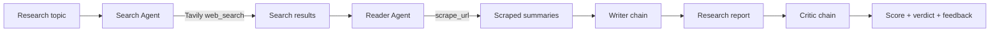

# LLM-Based Multi-Agent Research System

**From a research topic to a reviewed report**



- **Autonomous agents:** LLM-powered Search and Reader agents decide what to retrieve and which sources to read.
- **Specialized chains:** Writer synthesizes evidence; Critic checks quality, coherence, and accuracy.

---

# How the Pipeline Works

1. **Search** — `build_search_agent()` uses `web_search` to find relevant titles, URLs, and snippets.
2. **Read** — `build_reader_agent()` selects sources and calls `scrape_url(url)` to extract concise page content.
3. **Write** — `writer_chain` combines search results and scraped content into a structured report with references.
4. **Review** — `critic_chain` returns a `Score: X/10`, strengths, improvements, and an **Acceptable / Needs Improvement / Unacceptable** verdict.

**State-driven orchestration**

```text
state["search_results"]
        ↓
state["scraped_content"]
        ↓
state["report"]
        ↓
state["feedback"]  →  final report + review in Streamlit
```

**Benefits:** modular agents, traceable intermediate outputs, source-grounded writing, and an explicit quality gate before delivery.
